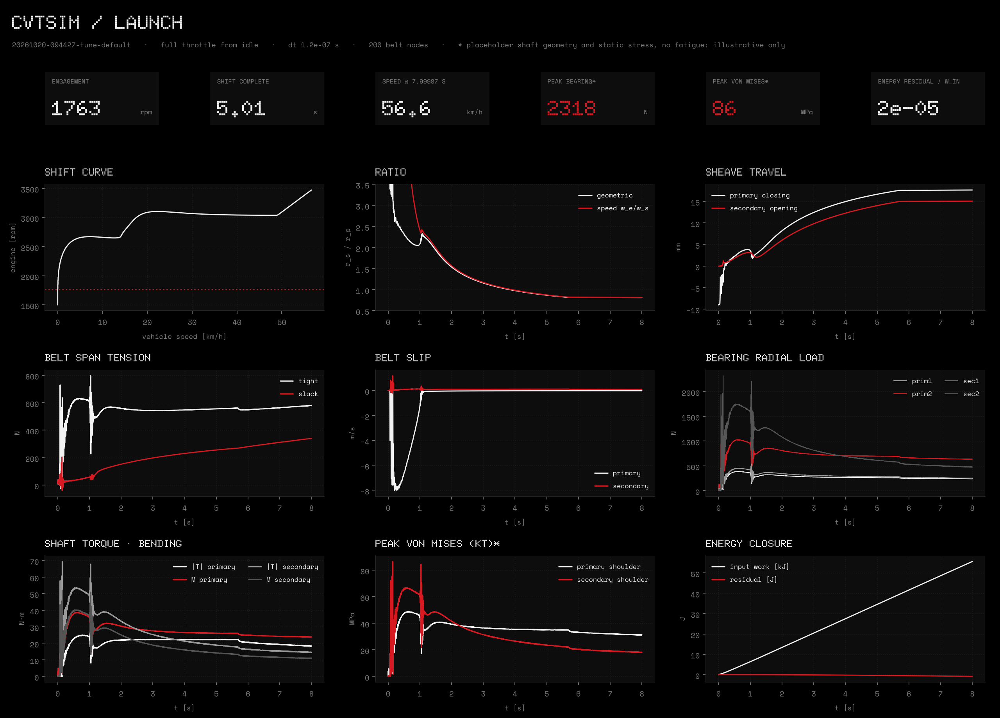

# cvtsim — status report

`cvtsim` simulates the DR26 rubber-belt CVT dynamically. It couples:
* a segmented belt with analytic cone sheaves;
* a flyweight primary with a profiled ramp;
* a helix secondary;
* the engine, a slipping tire and the vehicle.

Downstream, it computes shaft and bearing loads. The equations, sources and test targets are in
[`docs/theory/`](docs/theory/README.md). Measured data used for validation is in
[`docs/theory/10_validation.md`](docs/theory/10_validation.md). The working standard is
[`docs/WORKFLOW.md`](docs/WORKFLOW.md).

**Baseline run:** [`runs/20261020-094427-tune-default`](runs/20261020-094427-tune-default/), clean commit d6299ff.
**Tests:** 119 pass locally (`pytest -q`, about 12 min).

## 1. Baseline launch (default tune = team configuration "Boombox 2026")

| Quantity | Result | Measured band | Status |
|---|---|---|---|
| 100 ft (30.48 m) time | **4.42 s** | 3.9-5.3 s (SAE 2025-01-5069; 2010-01-0861: 4.1-4.5 s) | inside band; nothing was tuned to fit |
| 150 ft time | 5.62 s | — | — |
| Engagement (first primary clamp) | 1763 rpm | team static estimate 1726 rpm at contact | consistent (slack belt contacts at the hub) |
| Shift complete (primary at 95 % of stop) | 5.0 s | — | — |
| Speed at 8 s | 56.6 km/h, still accelerating 0.8 m/s² | top speed 53-63 km/h | quasi-static top speed 62.9 km/h (governed, belt losses ignored): upper edge of band |
| Energy closure | 1.5e-5 of input work | < 1e-4 | pass |



**What the launch looks like:**
* **Idle:** the belt is slack on the primary hub bearing.
* **Engagement:** at about 1760 rpm the flyweights throw the sheave closed over its 8.97 mm
  engagement travel. The sheave hits the belt at the hub radius and chatters.
* **Primary slip:** the belt slips on the primary at up to 7.8 m/s for about one second,
  like a slipping clutch.
* **Lock-up at 1.05 s:** the stick transition produces the peak belt tension, bearing load
  and shaft moment of the run.
* **Upshift:** the engine then holds about 3050 rpm through the upshift, which completes at 5.0 s.

Mechanism viewer: open [`viewer/index.html`](viewer/index.html) with `?run=` pointing to the run's
`viewer.json`. The page needs a local web server; `python -m http.server` from the repository root works.

## 2. Known limitations (from the adversarial review, ranked)

These are open and they change results. Tier 1 fixes (belt geometry, units, CLI crash, aero,
stale runs) are done. The review output is in the session log, and each item below is a tracked next step.

| # | Limitation | Effect | Needs |
|---|---|---|---|
| 1 | Engine torque is a mean map. There are no firing pulses and no crank/flywheel/clutch inertia split. | PTO and primary-shaft alternating torque, which drives fatigue, is missing. | Nothing (modelling work) |
| 2 | Stress is a single static peak on PLACEHOLDER shaft geometry. There is no fatigue (Goodman, Kf), no bearing L10, and no key/taper sections. | The "86 MPa" and "2318 N" figures are illustrative, not design values. | PTO and jackshaft dimensions, material, output gear position |
| 3 | No Coulomb friction at the ramp rollers, helix buttons or bushings. | Upshift and backshift follow one curve; secondary clamp is off by about ±20 %. The engagement impact is under-damped, so the settled sheave position is reproducible only to about 0.2 % (7 µm). | Nothing (modelling work); a measured shift curve to check |
| 4 | Slip, slip power and belt heat depend on the friction regularization `v_eps` and the assumed μ. | Absolute slip and heat are uncalibrated. | Sensitivity sweep; slip-vs-torque data |
| 5 | Only a flat full-throttle launch exists. | No landing, hill, backshift-under-load, throttle-lift or driveline wind-up cases. | Event definitions |
| 6 | Sheave stress and sheave temperature are not modelled. | Two stated goals are open. | Sheave CAD (STEP) and material |
| 7 | Rigid driveline from the secondary to the wheels. | No torsional mode or lash in the shaft loads. | Driveline stiffnesses |

## 3. Inputs: what is data and what is not

* **Team data (CVT_Inputs workbook, kept local):**
  * primary spring D and secondary spring A (rates, preloads), torsion 30°, 275 g flyweights + 38.7 g covers, cam A;
  * engagement travel xPi 8.97 mm, sheave radii, flank angle 12°, centre distance 232 mm, μ 0.3;
  * the engine dyno curve.
* **Literature:**
  * belt BD52-2179-S 895 mm (CVTech table, secondary source);
  * C_d 0.44 and C_rr 0.02 (SAE 2025-01-5069);
  * kit and trends from SAE 2010-01-0861.
* **Derived:**
  * low ratio 2.787 (secondary-limited, as in the team's `boundaryGeo`);
  * flyweight wedge κ = 0.5, which the team model confirms.
* **PLACEHOLDER / ASSUMED** (each flagged in `cvtsim/io/dr26_default.yaml`):
  * belt section, EI, damping;
  * sheave masses and inertias, engine inertia;
  * frontal area, tire μ and slip, wheel inertia, CG;
  * all shaft geometry, flank damping, friction regularization.

## 4. Verification (all pass)

Each module is tested against closed forms computed independently in
[`docs/theory/targets.py`](docs/theory/targets.py). The verification run
[`runs/20261020-072200-verification`](runs/20261020-072200-verification/) plots error against refinement.

| Module | Tests | Key checks |
|---|---|---|
| Rigid bodies (01) | 14 | pendulum periods to 1e-3; free-top precession 3.000 and 6.0828 rad/s; screw-joint dynamics to 1e-6; constraint drift ≤ 1e-10 with projection |
| Integrators (02) | 10 | orders 2.00 / 2.00 / 1.00; gen-α spectral radius = ρ∞; Verlet stability limit ωh = 2 |
| Belt (03) | 9 | stretch = PL/EA to 1e-9; beaded-string frequency 42.5278 Hz to 1e-4 |
| Contact (04) | 9 | V-groove capstan 3.7919 to 3e-4; thrust `T cos β/(2μR)` to 1e-4; penalty convergence; slip grows with load |
| Clutches (05) | 11 | engagement 1725.66 rpm, negative-stiffness onset 2262.57 rpm; secondary thrust; real-belt geometry 2.7867 |
| Drivetrain (06) | 8 | torque map, reflected inertia, steady-speed closed forms |
| Shafts (07) | 14 | Timoshenko deflections and reactions to 1e-5; stresses; Peterson fits (coefficients UNVERIFIED) |
| Tet10 FE (08) | 6 | patch test exact; cantilever error 8e-7; Kirsch SCF 2.9988 (error 4e-4) |
| Tunable parts, vehicle, belt heat (09) | 12 | profiled ramp and helix energy conservation; tire and slip closed forms; equivalence with the pre-library model to 1e-11 |
| Coupled system | 3 | energy closure; no drive below engagement; dt vs dt/2 after engagement to 1e-3 |
| I/O, viewer export, dashboards | 23 | workbook → SI reproduces the brief; viewer contract with a real simulation |

Corrections made to the spec during review (each derived, none loosened) are listed in the
commit history and in each spec's test table.

## 5. Not built yet

* Flexible bodies via Craig–Bampton.
* FE on real CAD parts (sheaves, PTO). The tet10 solver is verified, but there is no STEP/gmsh pipeline.
* A dropdown parts app (`cvtsim.app`), planned after the Tier 2 physics. The tune library and CLI exist:
  `python -m cvtsim.tune run default`, `python -m cvtsim.tune compare default heavy_flyweights`.

## 6. Reproduce

```
pip install -e .[fast,test]
pytest -q                                    # about 12 min
python -m cvtsim.tune run default --t-end 8  # about 30 min; writes a tracked run with dashboard and viewer.json
python examples/verification.py              # about 2 min
```
