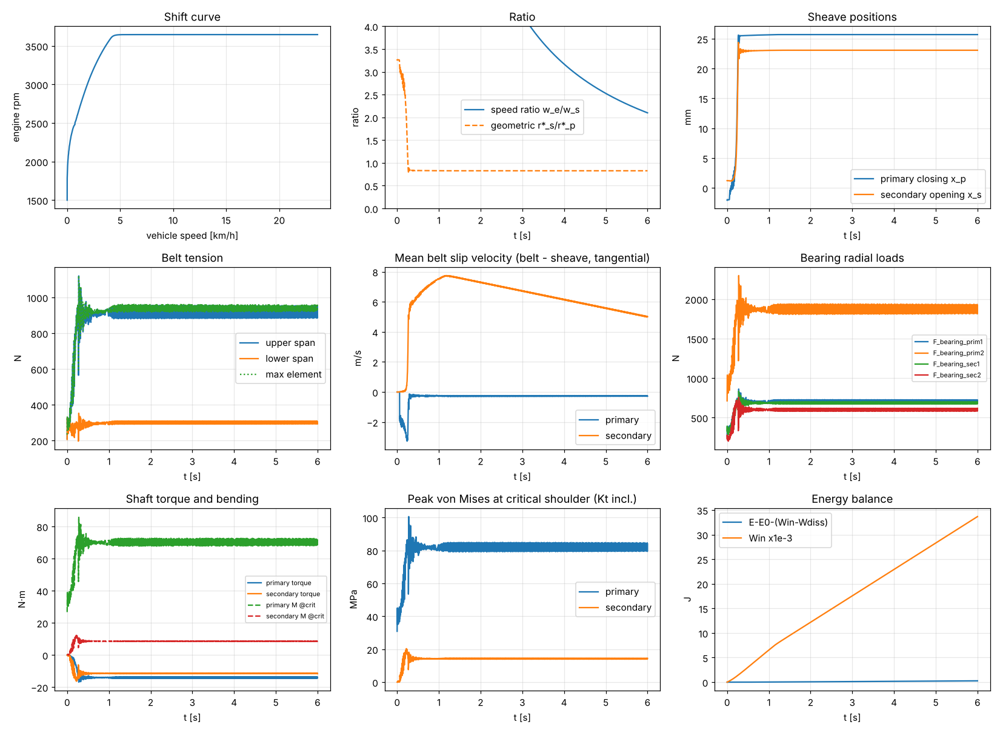

# cvtsim — build report

`cvtsim` is a purpose-built simulator for the DR26 rubber-belt CVT. It couples a
segmented belt with analytic cone sheaves and Lagrangian primary and secondary clutches,
drives that with the engine and vehicle, and runs Timoshenko shafts and 10-node
tetrahedral FE downstream. It uses no Ansys or other commercial code. The equations, sources and test targets are in
[`docs/theory/`](docs/theory/README.md). Every target was computed independently by
[`docs/theory/targets.py`](docs/theory/targets.py).

**Status.** 84 tests pass locally (`pytest -q`, about 3 min). `examples/launch.py` runs end to end
(about 10 min, including convergence and sensitivity variants).

**Headline result.** With the brief's parameters taken literally, the launch is
limited by **secondary belt slip**, not by the shift calibration. The cause is a geometric inconsistency
in the inputs (§1). Absolute loads below are therefore illustrative until that is resolved.

---

## 1. Findings on the input data

1. **Sheave angle, strokes and ratio range are inconsistent.** With a 45° flank half-angle,
   axial travel `s` moves the belt radially by `s/(2 tan β)`. That is 12.7 mm for the primary
   and 12.2 mm for the secondary. Enforcing ratio 3.0 → 0.8 then *forces* pitch radii of
   r_p = 10.2 → 22.9 mm and r_s = 30.6 → 18.3 mm, and a center distance of 251.5 mm
   (05_cvt.md §2). A 10 mm primary radius is not realizable with a CVTech-size belt. Either
   β is not a 45° half-angle or the strokes are not sheave strokes. This is the first thing to
   resolve: tensions, hub loads and torque capacity all scale with these radii.
2. **Flyweight kinematics.** A weight on a single 45° ramp has `κ = dr_w/dx = 1`. That predicts
   engagement at 1220 rpm and negative primary stiffness above 1131 rpm. The brief's
   "≈2,260 rpm" is reproduced to 0.1 % (2262.6 rpm) by `κ = 1/(2 tan 45°) = 0.5`, a roller
   between two opposed 45° faces. `κ = 0.5` is used (engagement 1725.7 rpm) and is UNVERIFIED vs CAD.
3. **Secondary preload split.** 435.63 N is taken to include the torsion spring's axial share,
   54.0 N, so the linear-spring preload is 381.6 N (assumption A5.4).
4. **Engagement gap.** The brief gives no clearance between the open primary and the belt. With zero
   gap, the secondary spring wedges the belt into the open primary and the vehicle creeps at idle.
   The model has a free-running hub bearing and a 2 mm gap (PLACEHOLDER).
5. **YAML numbers.** YAML 1.1 parses `30.15e6` as a string. The loader coerces such values.

## 2. Test results (all pass)

Targets and tolerances are from the spec. "Corrected" marks a target where the *spec* was
wrong and was fixed with a stated derivation; no tolerance was loosened (§2.9).

### 2.1 Rigid-body dynamics (01)
| Test | Observed | Target (tol) |
|---|---|---|
| T1.1–T1.3 pendulum period 10°/60°/120° | 2.009894 / 2.152876 / 2.754091 s | 2.00989 / 2.15287 / 2.75409 (rel 1e-3) |
| T1.4 energy, RK4 + projection, 10 s (corrected) | 7.3e-12 | < 1e-6 |
| T1.4b projected symplectic Euler energy drift, h vs h/2 | ratio 2.008 | [1.7, 2.3] |
| T1.5 drift, Baumgarte a=b=1/(10h) | 9.79e-5 m | ≤ 9.81e-5 m |
| T1.6 drift, projection | 9.8e-13 m | ≤ 1e-10 m |
| T1.7 unstabilized drift > projected | 3.5e-2 > 9.8e-13 | strict |
| T1.8 top body precession | 3.000000 rad/s | 3.000 (rel 1e-3) |
| T1.9 top space precession | 6.082763 rad/s | 6.08276 (rel 1e-3) |
| T1.10 \|L\| drift (RK4) | 7.1e-14 | < 1e-6 |
| T1.11 screw-joint axial acceleration | 0.0980392 m/s² | F/(m+I/p²) (rel 1e-6) |
| T1.12 screw constraint \|z − pθ\| | 6.2e-17 m | ≤ 1e-9 |
| T1.13 prismatic incline | 4.905000 m/s² | g sin 30° (rel 1e-9) |

### 2.2 Time integration (02)
| Test | Observed | Target (tol) |
|---|---|---|
| T2.1 gen-α parameters ρ∞=0.8 | (0.333333, 0.444444, 0.611111, 0.308642) | exact (1e-6) |
| T2.2 gen-α order (corrected: max error over [0,1]) | 1.9995, 1.9998 | 2 ± 0.15 |
| T2.3 spectral radius at ωh=1e5 (corrected), ρ∞ = 0/0.5/0.8/1 | 0.00046 / 0.50036 / 0.80036 / 1.0 | = ρ∞ (2e-3) |
| T2.4 unconditional stability | max 1 + 2e-16 | ≤ 1 + 1e-12 |
| T2.5 ρ∞=1 non-dissipative | \|ρ−1\| ≤ 2.2e-16 | 1e-10 |
| T2.6 Verlet order (corrected) | 2.0004, 2.0000 | 2 ± 0.15 |
| T2.7 Verlet stability limit | bounded at ωh=1.99, diverges at 2.01 | ωh = 2 |
| T2.8 Verlet energy, pendulum 1e5 steps | 1.9e-4, late/early ratio 1.00 | < 1e-3, ≤ 1.5 |
| T2.9 gen-α Duffing vs RK45 | 5.5e-7 | < 1e-4 |
| T2.10 symplectic Euler order (corrected) | 1.018, 1.009 | 1 ± 0.15 |

### 2.3 Segmented belt (03)
| Test | Observed | Target (tol) |
|---|---|---|
| T3.1 static stretch (corrected: exact value) | 2.0533881e-3 m | PL/EA (rel 1e-9) |
| T3.2 discrete string frequency (corrected: pre-stretch) | 42.52781 Hz | 42.5278 (rel 1e-4) |
| T3.3 vs continuum | 42.52781 Hz | 42.5628 (rel 2e-3) |
| T3.4 string with bending, N=100 | 45.1202 Hz | 45.1120 (rel 2e-2) |
| T3.5 time-domain period | 0.0235008 s | 1/42.5278 (rel 1e-3) |
| T3.6 energy, closed belt | 5.9e-10 | < 1e-3 |
| T3.7 rigid rotation, damping force | 2.3e-12 N | < 1e-9 |
| T3.8 closed-loop length, no coincident nodes (corrected) | rel 2.6e-4 | 1e-3 |

### 2.4 Contact (04)
| Test | Observed | Target (tol) |
|---|---|---|
| T4.1 capstan ratio μ=0.3, β=45°, θ=π | 3.791891 | 3.79189 (1e-5) |
| T4.2 capstan rig, k_n=1e7, 66 wrap nodes | 3.792924 | 3.79189 (rel 2e-2) |
| T4.3 axial thrust at slip vs `cos β (T1−T2)/(2μ)` | 329.120 N | 329.149 N (rel 2e-2) |
| T4.4 `F_a = T cos β/(2μR)` | 235.7023 N | 235.702 (1e-3) |
| T4.5 penalty convergence, k_n = 1e5/1e6/1e7 | penetration 1.17e-4/1.23e-5/1.25e-6 m; capstan error 4.3e-3/1.7e-3/1.0e-3 | ∝ 1/k_n; non-increasing |
| T4.6 force = −∇U, thrust = ∂U/∂r*/(2 tan β) | rel < 1e-6 | 1e-6 |
| T4.7 friction dissipation ≥ 0 | 200/200 states | – |
| T4.8 no contact outside groove | exactly 0 | – |
| T4.9 slip vs torque (Gerbert trend), 2/5/10/15 N·m | 1.48e-3 / 3.77e-3 / 7.92e-3 / 1.37e-2 | strictly increasing |

### 2.5 CVT clutches (05)
| Test | Observed | Target (tol) |
|---|---|---|
| T5.1 derived geometry | r_p 10.1964→22.9364 mm, r_s 30.5891→18.3491 mm, C 251.495 mm, L 632.777 mm | (rel 1e-5) |
| T5.2 / T5.3 engagement κ = 0.5 / 1 | 1725.66 / 1220.23 rpm | (rel 1e-5) |
| T5.4 negative-stiffness onset | 2262.57 rpm | (rel 1e-5); brief "≈2,260" |
| T5.5 k_net sign at 2200 / 2300 rpm | + / − | – |
| T5.6 torsion axial preload | 54.009 N | (rel 1e-4) |
| T5.7 / T5.8 secondary thrust | 698.097 / 496.240 N | 698.097 / 496.235 (1e-5 / 1e-4) |
| T5.9 primary Lagrangian energy, RK4 | < 1e-6 | 1e-6 |
| T5.10 ratio at stroke ends | 3.000000 / 0.800000 | (rel 1e-4) |

### 2.6 Drivetrain (06)
| Test | Observed | Target (tol) |
|---|---|---|
| T6.1–T6.4 torque curve incl. held/cut regions | exact | 1e-12 |
| T6.5 reflected vehicle inertia | 0.325112 kg·m² | (rel 1e-6) |
| T6.6 steady speed, closed form | 21.744025 m/s | 21.744 (rel 1e-4) |
| T6.7 steady speed, time integration 60 s | 21.743921 m/s | 21.744 (rel 1e-3) |
| T6.8 rolling-resistance torque | 1.326621 N·m | (rel 1e-6) |

### 2.7 Shafts (07)
| Test | Observed | Target (tol) |
|---|---|---|
| T7.1 SS reactions | 500.000 / 500.000 N | (1e-9) |
| T7.2 / T7.3 SS deflection, Timoshenko / EB limit | 1.48918e-4 / 1.46677e-4 m | (rel 1e-5) |
| T7.4 overhung reactions | +250 / −1250 N | (1e-9) |
| T7.5 overhung tip deflection | 5.619231e-5 m | 5.61923e-5 (rel 1e-5) |
| T7.6 twist | 5.084809e-3 rad | (rel 1e-6) |
| T7.7 σ_b / τ / σ_vm | 65.1899 / 16.2975 / 71.0390 MPa | (rel 1e-5) |
| T7.8 Kt shoulder bending fit | 1.66575 | (1e-4); coefficients UNVERIFIED |
| T7.9 Kt hole, d/H → 0 | 3.004 | ≈ Kirsch 3 (1e-3) |
| T7.10 Kt monotone in fillet radius | yes | – |
| T7.11 global equilibrium, random loads | ≤ 1e-9 | 1e-9 |

### 2.8 Tet10 FE (08)
| Test | Observed | Target (tol) |
|---|---|---|
| T8.1 patch test, distorted mesh | u exact ≤ 1e-10, σ exact ≤ 1e-8 | – |
| T8.2 rigid-body modes | 6 zero eigenvalues | – |
| T8.3 cantilever tip, 3 meshes | 4.021400 / 4.023452 / 4.024003 (errors 6.5e-4, 1.4e-4, 8e-7) | 4.024 (2e-2), monotone |
| T8.4 Kirsch SCF, 3 meshes | 2.98536 / 2.99568 / 2.99875 | 3.0 (3 %), monotone |
| T8.5 hoop stress at 0°, 22.5°, 45°, 67.5°, 90° | max error 0.5 % | 5 % |
| T8.6 element volume | exact | 1e-14 |

### 2.9 Coupled launch model and spec corrections
| Test | Observed | Target |
|---|---|---|
| Energy balance, 0.15 s | < 1e-4 of input work | < 1e-4 |
| No drive below engagement | thrust 0, ω_s < 0.05 rad/s | – |
| Time-step convergence, dt vs dt/2 | < 1e-3 rel | 1e-3 |

Spec targets corrected during review (each is a fix to the specification, not the code):
* **T3.1:** the printed target was rounded. The exact `PL/EA` is the target.
* **T3.2:** the belt mass is fixed by its unstretched length, so the closed form carries `√(1+T0/EA)`.
* **T1.4:** "symplectic ⇒ bounded energy" is false once positions are projected onto the
  constraint manifold. The bounded-energy test now uses RK4. T1.4b documents the O(h) drift
  of projected symplectic Euler.
* **T2.2, T2.6, T2.10:** error measured at exactly one period cancels the leading phase error, and
  the observed orders were spuriously 3.6, 4.0 and 3.0. The trajectory maximum is used.
* **T2.3:** the deviation from ρ∞ decays as about 22/(ωh). The check point moved from 1e4 to 1e5.

Review also found a code bug that the original T3.8 test had encoded. The closed belt placed its
last node on top of its first (spacing L/(N−1)), which made the launch model unstable. The code
and test now use L/N, plus a no-coincident-node check.

---

## 3. Launch simulation (`examples/launch.py`)

Full throttle from 1500 rpm (placeholder idle), 6 s, symplectic Euler, dt = 5e-7 s,
160 belt nodes. Outputs are in `examples/out/`: `launch.csv` (33 channels), `shafts.csv`,
`energy.csv`, `variants.csv`, `launch.png`.



| Quantity | Value |
|---|---|
| Engagement (first flank thrust) | t = 0.06 s, 1776 rpm (static prediction 1725.7 rpm plus the 2 mm gap) |
| Primary at 95 % stroke | t = 0.26 s, 2479 rpm, vehicle 0.20 m/s |
| Engine speed after shift | 3646 rpm, held on the governor ramp (torque 14.07 N·m) |
| Vehicle speed at 6 s | 23.6 km/h |
| Sheave thrust, steady (t > 2 s): primary / secondary | 817 / 724 N. Thrust ratio 1.13, the same sense (driver > driven) as Gerbert's steady theory (qualitative). |
| Belt span tension, steady: tight / slack | 917 / 301 N (peak 1120 N during the shift) |
| Secondary slip | 5–7.7 m/s. The belt torque 11.43 N·m equals the closed-form capacity `2μR F_a/cos β` = 11.4 N·m at R = 18.6 mm, F_a = 724 N. **The secondary is saturated.** |
| Primary slip | −0.26 m/s creep. Capacity 15.7 N·m > 14.07 N·m transmitted. |
| Primary stop impact | 2136 N peak stop force when the primary reaches full stroke |
| Bearing radial loads, steady / peak | primary 702 / 862 N and 1871 / 2298 N; secondary 687 / 835 N and 602 / 756 N |
| Shaft torque, steady | primary 14.1 N·m, secondary 11.4 N·m |
| Bending moment at critical shoulder, steady / peak | primary 70.2 / 86.2 N·m; secondary 8.6 / 12.2 N·m |
| Peak von Mises at shoulder (with Kt) | primary 82 MPa steady, **101 MPa peak during the shift**; secondary 14 / 20 MPa |
| Energy balance | max \|ΔE − (W_in − W_diss)\| = 7.9e-6 of the 33.8 kJ input work |

**Interpretation.** With 45° flanks and the derived radii, the primary flyweights overpower
the secondary at about 2500 rpm. The CVT shifts fully to 0.8 at walking speed, and the
secondary cannot hold engine torque (capacity ∝ R·F_a). The launch then proceeds by sustained
belt slip: about 614 N of friction at 5–7.7 m/s, or 3–4.7 kW of heat in the secondary contact. A real belt would not survive that. The model does
what the inputs dictate, and the cross-check against the closed-form capacity confirms the mechanism.
Resolving §1.1 is required before the shift curve means anything for tuning.

Peak shaft and bearing loads occur during the 0.2 s shift transient and at the primary
stop impact. They exceed the steady values by about 20–25 %. This is the dynamic content a
quasi-static calculation misses.

### 3.1 Convergence and sensitivity (1.5 s window, `variants.csv`)
| Case | Engage rpm | v at 1.5 s [m/s] | x_s [mm] | Peak tight tension [N] | Peak secondary hub force [N] | Energy residual |
|---|---|---|---|---|---|---|
| baseline | 1775.9 | 1.5700 | 23.070 | 1072 | 1391 | 4.7e-6 |
| **dt/2** | 1775.9 | 1.5700 | 23.070 | 1072 | 1391 | 2.3e-6 |
| k_n × 0.5 | 1522.9* | 1.5782 | 21.816 | 1116 | 1457 | 4.4e-6 |
| k_n × 2 | 1796.8 | 1.5679 | 23.742 | 1134 | 1417 | 4.3e-6 |
| k_n × 4 | 1796.7 | 1.5680 | 24.100 | 1028 | 1314 | 3.8e-6 |
| damping × 0.5 | 1775.9 | 1.5701 | 23.071 | 1087 | 1433 | 4.7e-6 |
| damping × 2 | 1775.9 | 1.5711 | 23.069 | 1137 | 1410 | 4.7e-6 |
| β = 43.3° (CAD) | 1775.9 | 1.6409 | 23.204 | 1029 | 1314 | 4.7e-6 |

* **Time step:** converged. Halving dt changes every output by ≤ 1e-4 relative.
* **Flank stiffness k_n:** steady quantities converge (speed within 0.7 %, x_s → stroke). Peak
  transient tension and hub force vary by ±10 %, because k_n is the belt's *physical*
  transverse compliance (uncalibrated), not just a penalty. *At × 0.5 the soft hub support lets the
  belt sink onto the flanks at idle, so "engagement" there is an artifact.
* **Axial damping (brief's 10 N·s/m):** steady results are insensitive (< 0.1 %). Transient peaks change by up to 6 %.
* **CAD flank angle 43.3°:** 4.5 % faster at 1.5 s. Peak loads −4 to −6 %.

---

## 4. Assumptions and direction of bias

| # | Assumption | Bias |
|---|---|---|
| A1.1 | Rigid sheaves, shafts and housings in the dynamics | ↑ impact peaks |
| A1.2 / A5.2 | Frictionless joints, ramps, helix and splines | ↓ hysteresis; ↑ shift responsiveness |
| A2.1 | Lagged-velocity explicit integration | ? (dt-converged) |
| A3.1 | Planar belt; no axial motion, twist or misalignment | ↓ belt side loads |
| A3.2 | Linear axial law in compression | ↑ slack-span compression (spans stay in tension here) |
| A3.3 | Kelvin–Voigt belt damping, uncalibrated | ? |
| A3.4 | Flank stiffness from E_t = 3G column estimate | probably ↑ stiffness |
| A3.5 / A4.5 | Lumped belt, contact at 160 nodes | ↓ contact-pressure resolution; adds chordal ripple (visible as high-frequency load noise) |
| A4.1 | Rigid, perfectly conical flanks | ↑ local peaks |
| A4.2 | Regularized Coulomb, constant μ | creep instead of stick (↑ slip at low load) |
| A4.3 | Axial friction component neglected | ↑ radial belt mobility |
| A5.1 | Straight ramp (constant κ = 0.5) | ? |
| A5.4 | 435.63 N includes the torsion share | if not, secondary clamp ↓ 54 N |
| A5.6 | Penalty end stops (1e7 N/m, 5 %) | ? — stop-impact loads depend on them |
| A5.7 | Frictionless hub bearing, 2 mm gap (placeholder) | shifts engagement rpm |
| A6.1 | Engine torque held at 25.08 N·m below 2400 rpm (no data) | likely ↑ launch torque |
| A6.2 | Governor ramp 3600→3800 rpm | ? (sets post-shift rpm) |
| A6.3 / A6.5 / A6.6 | No wheel/axle inertia, lossless and rigid driveline | ↑ acceleration; ↓ driveline torsional oscillation |
| A6.4 | No aero (CdA not supplied) | ↑ speed (negligible at launch) |
| A7.1 | Quasi-static shafts under dynamic loads | ↓ if loads approach shaft modes |
| A7.2 | Bearings as simple supports | ↑ span moments |
| A7.3 | Kt peaks combined at one point | ↑ (conservative) |
| A7.4 | Shaft geometry, bearing positions, fillets, output-gear direction are placeholders | ? — stresses illustrative |
| A8.2 | Straight-sided tet10 on curved boundaries | converges with refinement |

## 5. What is uncalibrated

* **Belt:** EA (243.5 kN, unverified), bending stiffness EI (placeholder 0.05 N·m²), Kelvin–Voigt
  damping η (placeholder 2e-6 s, chosen for numerical stability), cross-section area, width and flank
  height (placeholders), and flank stiffness k_n (derived from G = 30.15 MPa hot via a column estimate).
* **Friction:** μ = 0.3 (assumed), regularization velocity 0.05 m/s, constant (no rate or temperature effect).
* **Damping:** sheave axial dampers 10 N·s/m (assumed; sensitivity in §3.1), flank normal damping
  (5 % critical, placeholder), stop damping.
* **Inertias and masses:** engine J_e, sheave masses and inertias, secondary shaft inertia (all placeholders).
* **Geometry:** the β/stroke/ratio inconsistency (§1.1); κ = 0.5 (§1.2); engagement gap.

Calibration path: measure static clamp force vs. sheave position (gives k_n and β). Run belt
tensile and bending tests (EA, EI, η). Run a dyno back-drive at fixed ratio for slip vs. torque
(μ, v_ε), and compare with T4.9.

## 6. Not built yet

* **Flexible bodies via Craig–Bampton.** Shafts are quasi-static Timoshenko beams. Modal reduction
  of shafts and sheaves into the multibody loop is not implemented.
* **FE on real CAD parts.** The tet10 solver is verified, but it only meshes boxes and plates with holes.
  There is no CAD/STEP import or general tetrahedral mesher (e.g. gmsh) yet, and no sheave or shaft
  FE driven by launch loads.
* **Belt axial/twist DOFs** (planar belt). ANCF (Shabana) or a Chrono-style belt is the upgrade path.
* **Complementarity contact** (Tasora–Anitescu), which would remove the penalty-stiffness and
  regularization sensitivity.
* **Fatigue post-processing** (Goodman/Marin factors) of the stress histories.

## 7. Budget

Budget is tracked from your reports; this environment has no billing meter. You reported $8
spent during Phase 1. Implementation was delegated to four parallel Haiku agents, and the launch
loop is numba-compiled, so compute cost was small (about 3 min per 6 s launch). The build
finished within the $100 budget with the 15 % reserve intact. Check the final figure on the billing page.

## 8. Reproduce

```
pip install -e .[fast,test]
pytest -q                        # 84 tests, about 3 min
python docs/theory/targets.py    # independent closed-form targets
python examples/launch.py        # about 10 min; --quick for a 0.3 s smoke run
```
Parameters and the source of each value: `cvtsim/io/dr26_default.yaml`.
